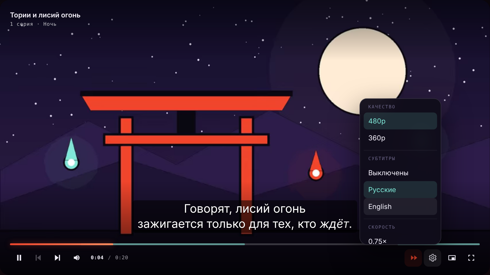
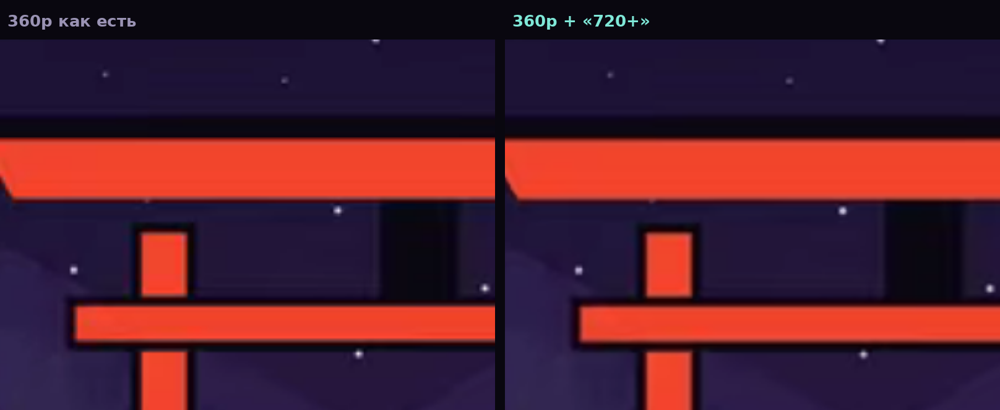

<div align="center">


# Yokaii Player — HTML5-плеер для аниме-сайтов

**Открытый видеоплеер на чистом JavaScript.** HLS (m3u8) и MP4, субтитры SRT и WebVTT,
пропуск опенинга и эндинга, улучшение картинки «720+» на WebGL, жесты на телефоне
и пульт Smart TV. Без зависимостей и сборки, лицензия MIT.

[**▶ Живое демо**](https://fut1le.github.io/yokaii-player/demo/) ·
[Сайт Yokaii](https://yokaii.web.app) ·
[API](docs/API.md) ·
[Как работает «720+»](docs/ENHANCE.md) ·
[English](README.en.md)

[](https://github.com/Fut1le/yokaii-player/releases)




</div>

---

На этом плеере смотрят аниме онлайн на [yokaii.web.app](https://yokaii.web.app). Мы вынесли
его в отдельный репозиторий, чтобы любой, кто делает аниме-сайт, онлайн-кинотеатр или
домашний медиасервер, мог взять готовый плеер, а не собирать его с нуля.

Плеер получает готовые ссылки на видео и ничего не знает о том, откуда они взялись.
В репозитории нет ни адресов чужих API, ни ключей, ни парсеров: только интерфейс поверх `<video>`.

## Возможности

| | |
|---|---|
| **Форматы** | MP4 и WebM напрямую, HLS (`.m3u8`) нативно в Safari, в остальных браузерах через [hls.js](https://github.com/video-dev/hls.js), который загружается только когда нужен |
| **Субтитры** | SRT и WebVTT с любого домена, несколько языков, выбор запоминается между сериями. Теги из фансабов вычищаются, фуригана через `<ruby>` работает |
| **Пропуск опенинга** | По точным меткам серии кнопка прыгает ровно на конец песни. Отрезки опенинга и эндинга видны на дорожке. Без меток — +1:30. Есть автопропуск |
| **Слабая сеть** | Видео встало — плеер сам включает качество полегче с той же секунды. Пропал интернет — ждёт и продолжает, а не показывает ошибку |
| **Серии** | Список серий, «следующая / предыдущая», продолжение с нужной секунды |
| **Качество и скорость** | Переключение качества без потери позиции, скорость от 0.75× до 2× |
| **«720+»** | Шейдерная доводка кадра на WebGL2 в духе [Anime4K](https://github.com/bloc97/Anime4K): подтягивает размытые границы заливок на 480p и 720p. [Честно о том, что это](docs/ENHANCE.md) |
| **Телефон** | Двойной тап по краю перематывает на 5 секунд, тап показывает и прячет панель. На iPhone касания не теряются после полноэкранного режима |
| **Клавиатура** | Как на YouTube: пробел, стрелки, <kbd>F</kbd>, <kbd>M</kbd>, <kbd>C</kbd>, цифры 0–9 для прыжка по процентам |
| **Smart TV** | Пульты Samsung Tizen, LG webOS, Android TV, медиакнопки клавиатуры и гарнитуры |
| **Экран блокировки** | Media Session: название серии и кнопки на экране блокировки и в шторке Android |
| **Картинка в картинке** | PiP там, где браузер умеет |
| **Языки** | Русский и английский интерфейс, любую подпись можно заменить |
| **Оформление** | Весь вид задаётся CSS-переменными: перекрасить под свой сайт можно в две строки |
| **Доступность** | ARIA-подписи, видимый фокус, уважение к `prefers-reduced-motion` |

## Быстрый старт: плеер на сайте за пять минут

Сборка не нужна. Скопируйте папку `src/` к себе или подключите с jsDelivr:

```html
<link rel="stylesheet" href="https://cdn.jsdelivr.net/gh/Fut1le/yokaii-player@1.1.0/src/yokaii-player.css">

<div id="player"></div>

<script type="module">
  import { YokaiiPlayer } from 'https://cdn.jsdelivr.net/gh/Fut1le/yokaii-player@1.1.0/src/index.js';

  const player = new YokaiiPlayer(document.getElementById('player'), {
    title: 'Название тайтла',
    poster: '/posters/title.jpg',
  });

  player.setEpisodes([
    {
      number: 1,
      title: 'Начало',
      sources: [                                   // от лучшего качества к худшему
        { src: '/video/ep1-720.m3u8', label: '720p' },
        { src: '/video/ep1-480.mp4',  label: '480p' },
      ],
      subtitles: [
        { src: '/subs/ep1.ru.srt', label: 'Русские', lang: 'ru', default: true },
      ],
      skip: { opening: { start: 85, stop: 175 } }, // секунды
    },
    { number: 2, sources: [{ src: '/video/ep2.m3u8', label: 'Авто' }] },
  ]);

  player.playEpisode(1);
</script>
```

Первый источник в списке — качество по умолчанию. На слабой сети плеер возьмёт последний.

### Запомнить, где человек остановился

```js
player.on('timeupdate', ({ episode, time }) => {
  localStorage.setItem(`progress:${episode}`, time);
});

const saved = Number(localStorage.getItem('progress:1')) || 0;
player.playEpisode(1, saved);
```

### Следующая серия сама

```js
player.on('ended', () => player.nextEpisode());
```

### Пульт телевизора

```js
import { YokaiiPlayer, attachRemote } from './src/index.js';

const player = new YokaiiPlayer(mount);
attachRemote(player, { tv: true }); // крупная панель, «ОК» — пауза, медиакнопки пульта
```

### Свои цвета

```css
.yplayer {
  --yp-accent: #7C5CFF;
  --yp-accent-glow: rgba(124, 92, 255, .5);
  --yp-fox: #FFD166;
}
```

Полный список опций, методов, событий и переменных есть в [docs/API.md](docs/API.md).

## Субтитры SRT и WebVTT

Передайте файлы в поле `subtitles` серии. Плеер скачает их сам, разберёт SRT или WebVTT
и покажет в меню «Субтитры». Клавиша <kbd>C</kbd> включает и выключает их.

```js
subtitles: [
  { src: 'https://cdn.example/ep1.ru.vtt', label: 'Русские', lang: 'ru', default: true },
  { src: 'https://cdn.example/ep1.en.srt', label: 'English', lang: 'en' },
  { text: srtString, label: 'Из базы', lang: 'ja' }, // можно и строкой
]
```

Что плеер делает за вас:

- **Чужой домен без `crossorigin` на видео.** Обычный `<track>` с другого сайта требует
  `crossorigin` у `<video>`, а это ломает видео с CDN без CORS. Плеер качает субтитры через
  `fetch`, поэтому видео не трогает.
- **SRT.** Браузеры понимают только WebVTT, плеер переводит SRT сам.
- **Фансабы.** Теги ASS вроде `{\an8}` и `<font color>` вычищаются, курсив, жирный
  и `<ruby>` остаются.
- **Поверх «720+» и над панелью.** Реплики рисует сам плеер, поэтому они не пропадают
  под шейдером и поднимаются, когда видна панель управления.
- **Запоминает язык.** Выбрал английские — следующая серия тоже включится с английскими.

Парсер можно использовать отдельно: `import { parseSubtitles, toVtt } from './src/index.js'`.

## Пропуск опенинга и эндинга

Если для серии известно, где начинается и кончается опенинг, передайте метки:

```js
skip: {
  opening: { start: 85, stop: 175 },
  ending: { start: 1320, stop: 1410 },
}
```

Пока идёт опенинг, кнопка пропуска подсвечивается и подписана честно: «Пропустить
опенинг — до 2:55». Нажатие или <kbd>S</kbd> прыгает ровно на конец. Отрезки видны
на дорожке ещё до перемотки. С опцией `autoSkip: true` плеер пропускает их сам,
но только один раз: если человек вернулся назад, значит, хочет посмотреть.

Меток нет — кнопка прыгает на полторы минуты вперёд **от текущего места**, а не на
фиксированную секунду: опенинг часто идёт после короткой сцены.

## Слабая сеть и обрывы связи

- **Видео встало.** Если буферизация длится дольше `stallTimeout` (9 секунд), плеер включает
  самый лёгкий источник с той же секунды и пишет «Слабая сеть — включаем 480p».
- **Медленное соединение с самого начала.** Если браузер сообщает о 2G/3G или экономии трафика,
  серия сразу стартует с лёгкого качества.
- **Пропал интернет.** Плеер ждёт сеть и продолжает с той же секунды. Так переживаются
  тоннели и переход Wi-Fi ↔ LTE.
- **HLS.** hls.js докачивает после обрыва и восстанавливается после сбоя декодера.
- **Повторы кончились.** На экране ошибки есть кнопка «Повторить».

Выбрал качество руками — плеер больше не переключает его за человека.

## Клавиши

| Клавиша | Действие |
|---|---|
| <kbd>Пробел</kbd>, <kbd>K</kbd> | Пауза / пуск |
| <kbd>←</kbd> <kbd>→</kbd> | Назад / вперёд на 5 секунд, с <kbd>Shift</kbd> на 30 |
| <kbd>↑</kbd> <kbd>↓</kbd> | Громкость |
| <kbd>S</kbd> | Пропустить опенинг или эндинг |
| <kbd>C</kbd> | Субтитры вкл / выкл |
| <kbd>N</kbd> / <kbd>B</kbd> | Следующая / предыдущая серия |
| <kbd>F</kbd> | На весь экран |
| <kbd>M</kbd> | Звук |
| <kbd>P</kbd> | Картинка в картинке |
| <kbd>0</kbd>–<kbd>9</kbd> | Прыжок на 0–90% серии |

Если на странице несколько плееров, клавиши достаются тому, в котором фокус.

## «720+»: что это и чем не является



Это **не нейросеть**. Настоящий ИИ-апскейл требует примерно гигафлоп на кадр,
и телефон с ним разрядится за двадцать минут. Здесь другой подход: в аниме после
сжатия страдает в основном одно место — границы между заливками расплываются
на два-три пикселя. Шейдер находит эти границы и подтягивает их обратно,
не трогая ровные заливки. Всё считается на видеокарте за доли миллисекунды.

Новых деталей обработка не добавляет, поэтому режим и называется «720+»,
а не «1080p». Разбор трёх проходов шейдера и найденных ошибок есть в [docs/ENHANCE.md](docs/ENHANCE.md).

По умолчанию режим выключен, потому что заметно греет телефон. Он работает с видео,
кадр которого браузер разрешает читать: файлы с вашего домена, HLS через hls.js
или CDN с CORS-заголовком.

## Чем отличается от Plyr и Video.js

Plyr и Video.js — отличные универсальные плееры. Yokaii Player уже: он сделан под аниме-сайт
и включает из коробки то, что там нужно в первую очередь.

| | Yokaii Player | Plyr | Video.js |
|---|---|---|---|
| Лицензия | MIT | MIT | Apache-2.0 |
| HLS (m3u8) | встроен, hls.js грузится сам | hls.js подключаете сами | встроен (VHS) |
| Субтитры SRT | ✅ | только WebVTT | только WebVTT |
| Метки опенинга и кнопка пропуска | ✅ | — | сторонние плагины |
| Снижение качества MP4 на слабой сети | ✅ | — | — (адаптивность только для HLS/DASH) |
| Улучшение картинки для аниме | ✅ «720+» на WebGL2 | — | — |
| Сборка и зависимости | не нужны | готовый бандл | готовый бандл |

Сравнение по документации проектов на октябрь 2026 года. Если что-то устарело, поправьте в PR.

## Где работает

| Платформа | Плеер | «720+» |
|---|---|---|
| Chrome, Edge, Яндекс Браузер 84+ | ✅ | ✅ |
| Firefox 90+ | ✅ | ✅ (без PiP) |
| Safari 15+ (macOS, iOS) | ✅ HLS нативно | ✅ |
| Samsung Tizen (ТВ 2022+) | ✅ | зависит от модели |
| LG webOS 22+ | ✅ | зависит от модели |
| Android TV (свежий WebView) | ✅ | ✅ |

Нижняя граница задана приватными методами классов (`#method`), они есть в Chromium 84+ и Safari 15+.

## Как устроено

```
src/
  index.js            точка входа: YokaiiPlayer, attachRemote, Enhancer, parseSubtitles
  yokaii-player.js    плеер: разметка, события, жесты, клавиши, серии, HLS, сеть
  subtitles.js        разбор SRT и WebVTT
  enhance.js          «720+»: WebGL2-шейдер и сторож первого кадра
  remote.js           пульт Smart TV, медиакнопки, Media Session
  utils.js            timecode, clamp, безопасный localStorage
  yokaii-player.css   все стили, только внутри .yplayer
demo/                 демо-страница (её же публикует GitHub Pages)
docs/                 API и разбор «720+»
```

Демо запускается любым локальным сервером. ES-модули не открываются через `file://`:

```bash
npx serve .          # или: python -m http.server
# открыть http://localhost:3000/demo/
```

## Безопасность

- В коде нет ключей, токенов и адресов сторонних API. Плеер работает только с ссылками, которые вы ему передали.
- Всё, что приходит извне (названия, подписи качества и субтитров, постер), попадает в страницу через `textContent` или экранируется. Текст субтитров собирается из разметки WebVTT браузером: только курсив, жирный и `<ruby>`, без скриптов и атрибутов.
- `destroy()` снимает все обработчики с `document`, освобождает WebGL-контекст и blob-ссылки субтитров.

Нашли уязвимость? Напишите по контактам из [SECURITY.md](SECURITY.md), а не в открытые issues.

## Частые вопросы

**Как сделать плеер для своего аниме-сайта?**
Подключите `src/` и передайте плееру список серий со ссылками на видео, как в «Быстром старте».
Откуда брать ссылки, решает ваш сайт.

**Как добавить субтитры SRT к видео на сайте?**
Передайте ссылку на `.srt` в поле `subtitles` серии. Переводить в WebVTT не нужно, плеер
сделает это сам. Если файл лежит на другом домене, тот должен отдавать CORS-заголовок.

**Как сделать кнопку «Пропустить опенинг»?**
Она уже есть. Передайте метки `skip.opening` с секундами начала и конца, и кнопка будет
прыгать ровно на конец опенинга. Без меток она перематывает на 1:30 вперёд.

**Как воспроизвести HLS (m3u8) в браузере?**
Передайте ссылку на `.m3u8` как обычный источник. В Safari поток играет нативно,
в Chrome и Firefox плеер сам загрузит hls.js. Если jsDelivr у ваших зрителей недоступен,
положите hls.js к себе и передайте `hlsUrl: ['/js/hls.min.js', 'https://cdn.jsdelivr.net/…']`.

**Как подключить в React, Vue или Svelte?**
Создайте плеер, когда компонент появился на странице (`useEffect`, `onMounted`, `onMount`),
и вызовите `player.destroy()`, когда он исчезает. Плеер сам ничего не знает о фреймворке.

**Видео не играет на iPhone.**
iOS не умеет полноэкранный режим для `div`, поэтому плеер переключается на нативный
полноэкранный `<video>`. Если не запускается сам поток, проверьте, что сервер отдаёт
заголовок `Accept-Ranges` и корректный `Content-Type`.

**«720+» включается и сразу выключается.**
Скорее всего, видео приходит с чужого домена без CORS, и браузер запрещает читать кадр.
Передайте `crossOrigin: 'anonymous'` в источнике, если CDN отдаёт CORS-заголовки, или
используйте HLS через hls.js.

**Можно ли использовать в коммерческом проекте?**
Да, лицензия MIT это разрешает. Сохраните файл `LICENSE` с копирайтом.

## Участие

Баги и идеи — в [Issues](https://github.com/Fut1le/yokaii-player/issues). Перед пул-реквестом
прочитайте [CONTRIBUTING.md](CONTRIBUTING.md). Что изменилось в версиях — в [CHANGELOG.md](CHANGELOG.md).

Если плеер пригодился, поставьте звезду ⭐: так его проще найти другим.

## Лицензия

[MIT](LICENSE) © 2026 Владимир, [Yokaii](https://yokaii.web.app).

Демо-ролик «Тории и лисий огонь» и субтитры к нему сделаны для этого репозитория
и распространяются по той же лицензии. Фильмы Blender Foundation в демо распространяются по CC BY.
